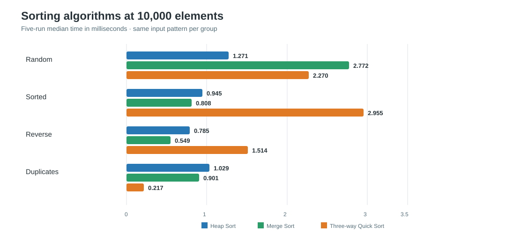
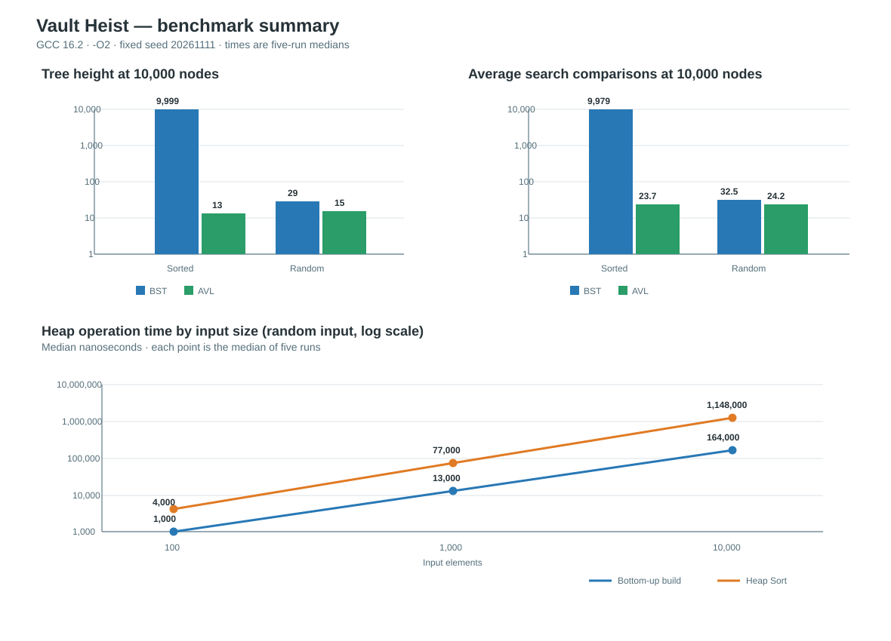

# Vault Heist Benchmark Results

**Run date:** 12 November 2026  
**Compiler:** GCC 16.2.0, `-std=c++17 -O2`  
**Input seed:** 20261111  
**Method:** benchmarks ran without the GUI. Each timing is the median of five runs; input generation and tree construction are outside the timed section except for AVL insertion. CPU model details were unavailable in the run environment, so absolute timings should be treated as machine-specific. Raw rows are in `benchmark_results.csv` at the project root.

## Findings

### Tree height

Heights use the edge convention (a single node has height 0).

| Nodes | Input order | BST height | AVL height |
|---:|---|---:|---:|
| 100 | Sorted | 99 | 6 |
| 100 | Random | 12 | 7 |
| 1,000 | Sorted | 999 | 9 |
| 1,000 | Random | 22 | 11 |
| 10,000 | Sorted | 9,999 | 13 |
| 10,000 | Random | 29 | 15 |

Sorted insertion produces the expected degenerate BST chain. AVL stays shallow across input orders.

### Search

Each row uses 10,000 random successful searches in the same tree. Comparisons count the equality and ordering checks performed at visited nodes.

| Nodes | Input order | Structure | Average comparisons | Median time for 10,000 searches |
|---:|---|---|---:|---:|
| 10,000 | Sorted | BST | 9,979.296 | 558.411 ms |
| 10,000 | Sorted | AVL | 23.719 | 1.491 ms |
| 10,000 | Random | BST | 32.548 | 2.836 ms |
| 10,000 | Random | AVL | 24.156 | 1.887 ms |

The sorted BST search cost grows with the chain length, while AVL keeps the comparison count near logarithmic. For the random trees, the comparison counts are similar in scale; these short timings are sensitive to machine load and should not be over-interpreted.

### AVL rotations

Rotation counts include each primitive left or right rotation; a double rotation counts as two. The sorted case inserts and deletes in ascending order. The random case uses shuffled insertion and deletion orders.

| Nodes | Input order | Operation | Total rotations | Average per operation | Maximum in one operation |
|---:|---|---|---:|---:|---:|
| 10,000 | Sorted | Insert | 9,986 | 0.999 | 1 |
| 10,000 | Random | Insert | 7,004 | 0.700 | 2 |
| 10,000 | Sorted | Delete | 4,988 | 0.499 | 1 |
| 10,000 | Random | Delete | 3,722 | 0.372 | 6 |

### Order statistics

The same 1,000 random `k` queries ran against 10,000 keys. The BST method scans inorder to find each answer; AVL uses subtree sizes. Both produced the same checksum (`5,064,536`).

| Method | Median time for 1,000 queries |
|---|---:|
| BST inorder scan | 325.142 ms |
| AVL subtree size | 0.278 ms |

### Heap construction and Heap Sort

Heap construction counts comparisons and swaps during bottom-up build. Heap Sort counts include the build and sorting operations performed by `MaxHeap::heapSort()`.

| Nodes | Input | Build median | Build comparisons | Build swaps |
|---:|---|---:|---:|---:|
| 100 | Random | 0.001 ms | 178 | 74 |
| 1,000 | Random | 0.013 ms | 1,877 | 744 |
| 10,000 | Random | 0.164 ms | 18,864 | 7,476 |
| 10,000 | Sorted | 0.077 ms | 19,982 | 9,992 |
| 10,000 | Reverse | 0.035 ms | 9,999 | 0 |

Random bottom-up construction comparisons grow by about 10 times when input size grows by 10 times, consistent with linear heap construction.

| Nodes | Input | Sort median | Comparisons | Swaps |
|---:|---|---:|---:|---:|
| 100 | Random | 0.004 ms | 1,034 | 584 |
| 1,000 | Random | 0.077 ms | 16,887 | 9,104 |
| 10,000 | Random | 1.148 ms | 235,396 | 124,187 |
| 10,000 | Sorted | 1.247 ms | 244,460 | 131,956 |
| 10,000 | Reverse | 1.076 ms | 226,682 | 116,696 |
| 10,000 | Duplicate-heavy | 0.936 ms | 218,070 | 112,771 |

Heap Sort comparisons rise by roughly 14 times for each 10-times input-size increase in the random cases, in line with `O(n log n)` growth. All benchmarked heap builds passed `isMaxHeap()`, all sorted outputs passed `is_sorted`, and the BST/AVL order-statistic checks matched.

### Sorting algorithm comparison

To complete the assignment's comparison experiment, the benchmark now includes hand-written Merge Sort and median-of-three, three-way Quick Sort alongside the project's Heap Sort. Inputs use the same sizes (100, 1,000, and 10,000) and random, sorted, reverse-sorted, and duplicate-heavy patterns. Five-run median time is reported; input copying happens before timing, while Merge Sort's scratch-array allocation is included. Every result is checked against a sorted reference before it is recorded. The raw file contains 36 rows for this experiment.

At 10,000 elements, measured median times were:

| Input | Heap Sort | Merge Sort | Three-way Quick Sort |
|---|---:|---:|---:|
| Random | 1.271 ms | 2.772 ms | 2.270 ms |
| Sorted | 0.945 ms | 0.808 ms | 2.955 ms |
| Reverse | 0.785 ms | 0.549 ms | 1.514 ms |
| Duplicate-heavy | 1.029 ms | 0.901 ms | 0.217 ms |

The implementation records comparisons plus swaps for Heap Sort and Quick Sort, and comparisons plus element moves for Merge Sort. At 10,000 random values, those counts were 235,156 comparisons / 124,098 swaps for Heap Sort, 120,451 comparisons / 267,232 moves for Merge Sort, and 221,947 comparisons / 115,808 swaps for Quick Sort. Merge Sort uses a 40,000-byte scratch array at this size (plus O(log n) recursion); Heap Sort uses O(1) auxiliary storage; Quick Sort uses O(log n) stack space in this implementation. Quick Sort's sorted and reverse inputs took many more comparisons in this run, illustrating its input sensitivity despite median-of-three selection. Timing differences at millisecond scale are machine-specific.



## Chart



## Reproduce

From the project root:

```powershell
C:\raylib\w64devkit\bin\g++.exe -std=c++17 -O2 -Wall -Wextra -Isrc -o benchmark.exe src\benchmark\benchmark.cpp src\models\BinaryTree.cpp
.\benchmark.exe | Set-Content -Encoding utf8 benchmark_results.csv
```

The `SORT_COMPARE` rows in the CSV include the algorithm, size, input pattern, median nanoseconds, comparison count, swaps or moves, auxiliary array bytes, and maximum recursion depth.
